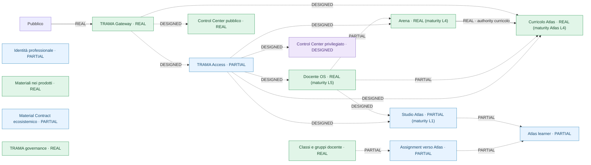
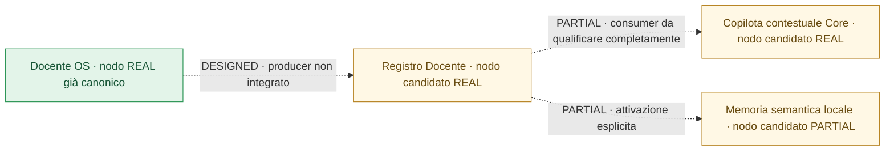

# TRAMA — Ecosystem State Map v0.3 | riesame AS IS → GAP → TO BE del 3 novembre 2026

**Stato:** `READ_ONLY_AUDIT / CANDIDATE_ADMISSION / HUMAN_REVIEW_PENDING`  
**Baseline letta:** `trama-ecosistema/main@62b61d462d7e3084c31a7c535c6bdfae021616be`  
**Grafo canonico:** `governance/access/trama-ecosystem-state-v0.3.json` (`asOf=2026-10-17`)  
**Proposta derivata, NON proiettata:** `docs/evidence/ecosystem-state-v0.3-admission-candidates-2026-11-03.json`  
**Effetto sul runtime / sui prodotti / su Production:** NESSUNO

## 1. Risultato del riesame

La versione **v0.3 non va ricreata**: è già integrata tramite [TRAMA #275](https://github.com/antoniocorsano-boop/trama-ecosistema/pull/275), con validatore fail-closed, grafo canonico, proiezione `ecosystemGraph` nello snapshot e due viste del Control Center: **Mappa governata** e **AS IS → GAP → TO BE**. Il Control Center è un lettore, non un'autorità.

La base del 17 ottobre documenta **15 nodi, 16 flussi e 25 voci di gap** secondo la selezione canonica `selectGapEntries` (comprende gap probatori anche su nodi REAL). I conteggi di realizzazione sono:

| Elemento | REAL | PARTIAL | DESIGNED | DEFERRED |
|---|---:|---:|---:|---:|
| Nodi (15) | 8 | 6 | 1 | 0 |
| Flussi (16) | 2 | 5 | 9 | 0 |

**Ruling:** non cambiare `asOf`, stati, target, evidenceRefs o snapshot del grafo canonico sulla sola base di questo riesame. La certificazione del 17 ottobre rimane un fatto storico; questa nuova osservazione deve prima essere ammessa come delta governato.

## 2. Mappa AS IS — struttura canonica, senza nuovi archi

Il seguente diagramma è una vista *derivata* dei 15 nodi/16 flussi e non costituisce una seconda fonte autorevole.

**Nota di lettura:** i livelli L5/L4/L1 sono letti dal registro di maturità e non sono equivalenti al colore REAL/PARTIAL. Le linee tratteggiate riportano la natura non pienamente qualificata del flusso; per lo stato puntuale di ogni arco fanno fede i record JSON e la vista interattiva. `professional_identity`, `materials_in_products`, `material_contract` e `trama_governance` possono apparire senza archi: la mappa non inventa relazioni assenti dalla fonte.

## 3. Delta verificabile dal 17 ottobre al 3 novembre

| Elemento | Evidenza successiva | Decisione del riesame |
|---|---|---|
| **Docente OS** | [DOS-M5-03 / TRAMA #274](https://github.com/antoniocorsano-boop/trama-ecosistema/pull/274) integrata: L5 nel registro di maturità | **Nessuna promozione del nodo**: è già REAL; maturity L5 rimane autorità separata |
| **Registro Docente** | [FLOW-04 #114](https://github.com/antoniocorsano-boop/registro-docente/pull/114) integrata con qualificazione; [LOCAL-REG-02 #293](https://github.com/antoniocorsano-boop/trama-ecosistema/pull/293) integrata con prova Android/Termux di avvio a freddo | **Candidato nuovo nodo**, REAL nel confine applicativo verificato, senza livello L inventato |
| **Contextual Copilot Core** | [TRAMA #279](https://github.com/antoniocorsano-boop/trama-ecosistema/pull/279), [#283](https://github.com/antoniocorsano-boop/trama-ecosistema/pull/283): libreria condivisa integrata | **Candidato nuovo nodo cross-cutting**, REAL come libreria, non server/authority autonoma |
| **Memoria semantica locale** | [LSM-01D #291](https://github.com/antoniocorsano-boop/trama-ecosistema/pull/291), [LSM-01E #292](https://github.com/antoniocorsano-boop/trama-ecosistema/pull/292), [Registro #99](https://github.com/antoniocorsano-boop/registro-docente/pull/99): prove consumer/hardware | **Candidato nuovo nodo**, PARTIAL per confine di adozione ecosistemica, pur con runtime locale verificato |
| **Docente OS → Registro Docente** | Producer [Docente OS #770](https://github.com/antoniocorsano-boop/docente-os-2026-27/pull/770) e qualifiche correlate ancora **non integrate** | **Candidato nuovo flusso DESIGNED**, non REAL |
| **Registro Docente INT-01** | [Registro #116](https://github.com/antoniocorsano-boop/registro-docente/pull/116) aperta il 3 novembre | Non anticipare nel grafo un percorso ancora non integrato |

Le nuove capacità non sono nuovi domini di authority: il Copilota non decide, la memoria semantica è un indice **derivato e ricostruibile** e il Registro conserva la propria autorità applicativa. La presenza di codice o di due prodotti funzionanti non dimostra da sola una loro integrazione end-to-end.

## 4. Integrazioni candidate — da verificare prima della proiezione

**Questi 3 nodi e 3 archi NON sono ancora nello snapshot del Control Center**. Sono proposte di ammissione, non stato promosso. La proposta strutturata è archiviata nel JSON associato a questo documento. Per renderli canonici occorrono autorità, evidenceRefs e qualificazione exact-head sullo schema v0.3 esistente; nessun secondo archivio autorevole.

## 5. AS IS → GAP → TO BE — decisioni importanti

| AS IS verificato | GAP da chiudere | TO BE / prossimo intervento ammesso |
|---|---|---|
| Gateway pubblico REAL; Access PARTIAL | Nessun journey professionale live completo | Qualificare prima un pilota Access, poi l'ingresso; non aprire federazioni in anticipo |
| Arena REAL e sincronizzazione verso Curricolo Atlas REAL | Mancano prove di stabilità L5, non funzioni curricolari di base | Raccolta di regressioni/versioni reali |
| Docente OS REAL, maturity L5 | Flussi verso altri prodotti qualificati solo in parte | Congelamento del prodotto, qualifiche mirate soltanto sui journey necessari |
| Studio Atlas PARTIAL, learner PARTIAL | Contratti e pubblicazione learner end-to-end non tutti qualificati | Un caso reale alla volta, privacy-first |
| Materiali nei prodotti REAL, contratto condiviso PARTIAL | Riferimenti/ownership/provenienza non uniformi | Qualificare il contratto minimo, senza un nuovo archivio concorrente |
| Registro Docente operativo ma non nella v0.3 | Nuova copertura topologica non recepita | Human Review di confini Registro / Copilota / memoria, poi integrazione nella v0.3 |
| Docente OS → Registro non integrato | Producer e interoperabilità aperti | Non promuovere il flusso fino a prova produttore+consumer exact-head |
| Control Center pubblico REAL | Controllo privilegiato ancora DESIGN | Nessuna implementazione finché non esista una necessità protetta e l'entitlement con MFA |

## 6. Invarianti e criterio di ammissione

1. `governance/access/trama-ecosystem-state-v0.3.json` resta **l'unica autorità di topologia e realizzazione**; `v0.2` è storia immutabile.
2. Maturità (`L0…L5`), lifecycle, authority, runtime e realizzazione (`REAL/PARTIAL/DESIGNED/DEFERRED`) restano **dimensioni diverse**.
3. Nessun diagramma, import, PR aperta, test isolato o libreria installata autorizza una promozione di nodo o arco.
4. `DOS-A1=RUNTIME_DEFERRED`; Control Center READ_ONLY; nessuna identità studente nominale per impostazione predefinita.
5. Prima di ammettere i nuovi soggetti nella v0.3: verificare responsabilità e contratti; aggiungere receipt locale referenziabile; aggiornare grafo e test, rigenerare lo snapshot canonico, qualificare layout/accessibilità e ottenere Human Review per i nuovi confini.

**Ruling:** questo dossier rende ispezionabile l'evoluzione dell'ecosistema senza falsare la baseline certificata. La prossima integrazione deve essere una *variazione minima del grafo esistente*, non una nuova applicazione o una nuova mappa parallela.

## 7. Fonti verificate

- [TRAMA #275 — grafo v0.3 integrato](https://github.com/antoniocorsano-boop/trama-ecosistema/pull/275)
- [TRAMA #274 — Docente OS L5](https://github.com/antoniocorsano-boop/trama-ecosistema/pull/274)
- [Registro Docente #114 — FLOW-04 integrato](https://github.com/antoniocorsano-boop/registro-docente/pull/114)
- [TRAMA #293 — supervisor Registro con prova cold-start](https://github.com/antoniocorsano-boop/trama-ecosistema/pull/293)
- [TRAMA #292 — servizio memoria semantica locale](https://github.com/antoniocorsano-boop/trama-ecosistema/pull/292)
- [TRAMA #291 — session bridge memoria](https://github.com/antoniocorsano-boop/trama-ecosistema/pull/291)
- [TRAMA #279/#283 — Copilota Core](https://github.com/antoniocorsano-boop/trama-ecosistema/pull/283)
- [Docente OS #770 — proiezione verso Registro non integrata](https://github.com/antoniocorsano-boop/docente-os-2026-27/pull/770)

Questo è un audit **read-only**, non un'autorizzazione di merge della futura estensione del grafo, deploy o attivazione di runtime.
